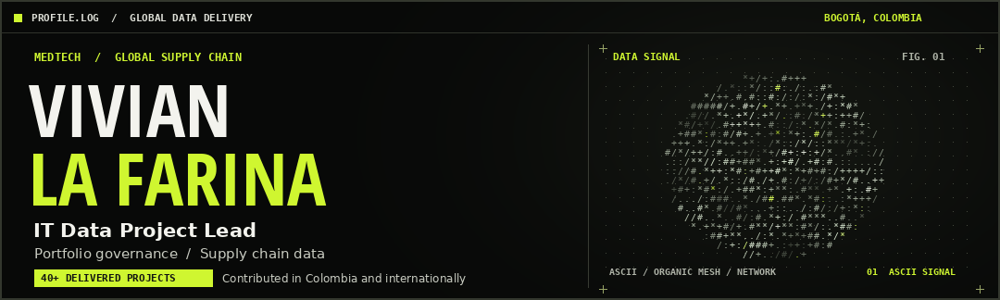
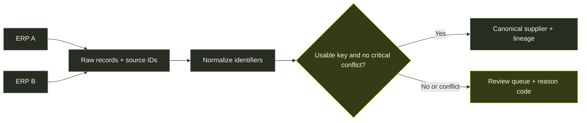

<p align="center">
  <picture>
    <source media="(prefers-reduced-motion: reduce)" srcset="./assets/data-ascii-static.png" />
    
  </picture>
</p>

<p align="center">
  <a href="#delivery-scope">Delivery scope</a> ·
  <a href="#supplier-master-data-lab">Architecture lab</a> ·
  <a href="https://www.linkedin.com/in/vivianlafarina/">LinkedIn</a> ·
  <a href="https://vivianlf.netlify.app/">Portfolio</a>
</p>

## Delivery scope

I’m an **IT Data Project Lead** focused on medtech and global supply chain. I lead enterprise data workstreams across the **Americas, EMEA, and APAC**, translating supplier and purchasing data requirements into delivery plans and coordinating architecture reviews, validation, and handoffs.

Across my career, I’ve contributed to **40+ delivered projects** with impact in Colombia and internationally.

```text
DATA DELIVERY CONSOLE
01  SAP MASTER DATA     Supplier standardization · purchasing data quality
02  PORTFOLIO CONTROL   Stage gates · dependencies · risks · escalation
03  DELIVERY READINESS  User acceptance testing · role-based access · onboarding
```

<details open>
<summary><strong>01 / SAP master data & release readiness</strong></summary>

Lead supplier data standardization workstreams and coordinate SAP purchasing data remediation, including price-date controls. Work with regional business teams and engineering on quality requirements, user acceptance testing, architecture reviews, and release handoffs.

</details>

<details>
<summary><strong>02 / Portfolio governance</strong></summary>

Oversee Planisware project updates for **15 data professionals** across regions. Track milestones, delivery risks, and blockers that need escalation so leadership can see where decisions or follow-up are needed.

</details>

<details>
<summary><strong>03 / Cross-functional team readiness</strong></summary>

Led onboarding for **50 professionals** across disciplines, coordinating role-specific system access and helping resolve setup blockers so team members could begin project work.

</details>

*Based in Bogotá, Colombia. I travel as part of my role.*

## Supplier Master Data Lab

**In development · Synthetic ERP data only · Python, SQL, DuckDB**

**Business problem:** Two ERP systems can assign different IDs to the same supplier. Duplicates fragment spend reporting, but false merges can make the data less trustworthy. The lab uses a conservative matching rule and a review queue for exceptions.



| Design choice | How I’ll apply it |
| :--- | :--- |
| **Entity resolution** | Match on a normalized tax ID in the demo, never on name alone. A multi-country implementation would scope the key by issuing jurisdiction and ID type. Format checks do not verify legal identity. |
| **Survivorship** | Specify which source takes precedence for each field. Keep original values and route conflicting critical attributes to review instead of overwriting them silently. |
| **Lineage** | Preserve each source system and original record ID. Record a reason code for exceptions so each decision can be traced back. |
| **Idempotency** | Run the same inputs twice and compare the full supplier, lineage, and review outputs. A stable supplier count alone can hide duplicate source mappings or review entries. |

**First acceptance test:** Four synthetic rows should yield **two canonical suppliers and one review case**, with all four source rows accounted for. These are expected results, not production metrics.

<details>
<summary><strong>Tools and platforms</strong></summary>

SAP master data · Planisware · Jira · Confluence · SQL · Power BI · Snowflake · Azure · Microsoft Fabric

</details>
