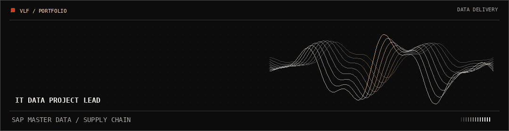
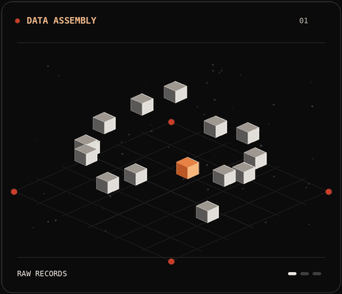
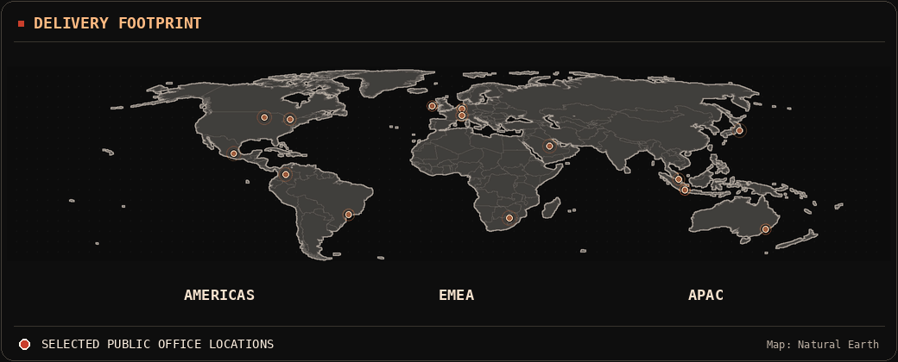
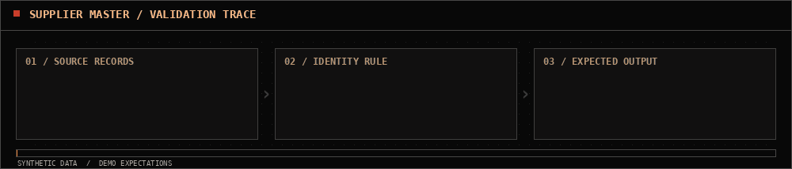
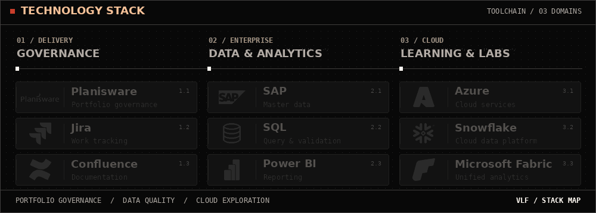
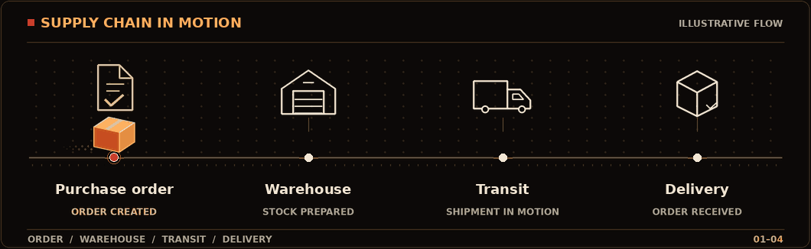

  <picture>
    <source media="(prefers-reduced-motion: reduce)" srcset="./signal-cover-bruno-offset-static.png" />
    
  </picture>

**IT Data Project Lead | SAP Master Data & Global Supply Chain**

<table width="100%">
  <tr>
    <td width="46%" valign="middle" align="center">
      <picture>
        <source media="(prefers-reduced-motion: reduce)" srcset="./data-cubes-red-static.png" />
        
      </picture>
    </td>
    <td width="54%" valign="middle">
      
I lead supplier and purchasing data initiatives in medtech across the <strong>Americas, EMEA, and APAC</strong>, from requirements to validation and release.

    </td>
  </tr>
</table>

[Selected work](#selected-work) · [Supplier data lab](#supplier-master-data-lab) · [LinkedIn](https://www.linkedin.com/in/vivianlafarina/) · [Portfolio](https://vivianlf.netlify.app/)

## Selected work

### SAP purchasing data quality | Price-date controls

I coordinate remediation of SAP purchasing data where date controls affect which price is used. My role spans regional requirements, architecture reviews, user acceptance testing, and release handoffs. The validation question is concrete: does SAP select the intended price for the relevant purchasing date?

### Portfolio governance | Global delivery

- Contributed to **40+ delivered projects** across my career, with impact in Colombia and internationally.
- Oversee Planisware project updates for **15 data professionals**, surfacing milestones, dependencies, and risks that need escalation.
- Led onboarding for **50 professionals** across disciplines, coordinating role-specific system access and helping resolve setup blockers.

Based in Bogotá, Colombia. I travel for work.

### Delivery footprint

<picture>
  <source media="(prefers-reduced-motion: reduce)" srcset="./delivery-world-arcs-static.png" />
  
</picture>

**Project scope:** Americas, EMEA, and APAC. Red dots show selected publicly listed office locations; the animated connections are illustrative and do not represent project deployments.

Countries marked on the map

- **Americas:** Canada, United States, Mexico, Colombia, Brazil
- **EMEA:** Ireland, Germany, Switzerland, Saudi Arabia, South Africa
- **APAC:** Japan, Singapore, Indonesia, Australia

## Supplier Master Data Lab

**Portfolio prototype · Python, SQL, SQLite · Synthetic ERP data**

Two ERP systems can list the same supplier under different names and IDs. A false merge can be harder to unwind than a duplicate, so the prototype matches on **country + normalized tax ID**, never on name alone. It retains the source IDs for traceability and routes missing identifiers or conflicting entity types to a review queue.

<picture>
  <source media="(prefers-reduced-motion: reduce)" srcset="./supplier-trace-red-title-static.png" />
  
</picture>

- **Match boundaries:** The same tax ID in two countries does not merge those suppliers.
- **Traceability:** Four source rows produce two canonical suppliers and one manual review case; all four source rows are accounted for.
- **Repeatability:** Rerunning the same input produces identical export files.

## Tools & platforms

- **Delivery and governance:** Planisware, Jira, Confluence
- **Enterprise data and analytics:** SAP master data, SQL, Power BI
- **Cloud learning:** Azure, Snowflake, Microsoft Fabric

<picture>
  <source media="(prefers-reduced-motion: reduce)" srcset="./technology-stack-red-checkpoints-static.png" />
  
</picture>

<!-- Technology marks identify their respective products. Artwork: Simple Icons, Devicon, Planisware, and Microsoft Learn. -->

<!-- Schematic regional map artwork made with Natural Earth. -->

## Supply chain

<picture>
  <source media="(prefers-reduced-motion: reduce)" srcset="./supply-chain-compact-trail-static.png" />
  
</picture>

**Purchase order** → **Warehouse** → **Transit** → **Delivery**
