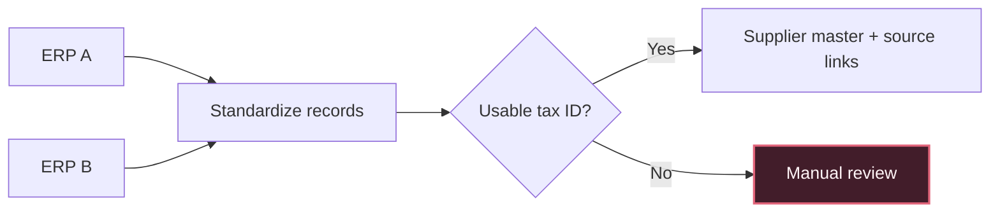

# Vivian La Farina

**IT Data Project Lead | Global Supply Chain Data & Portfolio Governance**

I lead enterprise data projects across the Americas, EMEA, and APAC. I bring regional business teams and global engineering teams together to improve the quality and governance of SAP supplier and purchasing data.

[LinkedIn](https://www.linkedin.com/in/vivianlafarina/) · [Portfolio](https://vivianlf.netlify.app/)

## What I lead

- **Global data delivery.** Lead cross-regional projects in supplier and purchasing data and coordinate architecture reviews with business and engineering teams.
- **Portfolio governance.** Oversee Planisware project updates for 15 data professionals, giving leaders visibility into milestones, project status, and blockers.
- **Cross-functional onboarding.** Led onboarding for 50 professionals across disciplines, coordinating role-specific system access and helping resolve setup blockers.

*Based in Bogotá, Colombia. I travel as part of my role.*

## Architecture lab: Supplier Master Data Platform

**In development · Synthetic data only · Python, SQL, DuckDB**

Two ERP systems can list the same supplier under different names and IDs. How do we consolidate those records without merging the wrong companies?

**Design decision:** In this demo, match on tax ID rather than name alone. Keep both source IDs so a match can be traced back, and send records without a usable tax ID for manual review.

**Validation plan:** Reload the same file without creating duplicate supplier records, source links, or review entries.

<strong>Tools and platforms</strong>

- **Portfolio delivery:** Planisware, Jira, Confluence
- **Enterprise data and analytics:** SAP/MDG, SQL, Power BI
- **Cloud data platforms:** Azure, Snowflake, Microsoft Fabric

