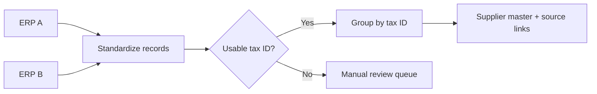

<h1 align="center">Vivian La Farina 👋</h1>

  <strong>IT Data Project Lead</strong> 
  Global Supply Chain · Portfolio Governance · Data Architecture

  
  

## 🌍 Global data delivery at a glance

| 🌐 Global reach | 📊 Planisware governance | 🤝 Onboarding |
| :--- | :--- | :--- |
| **Americas · EMEA · APAC** | **15 data professionals** | **50 professionals** |
| Regional teams impacted by the data projects I lead | I oversee updates to their projects in Planisware | I’ve led their onboarding across disciplines |

I lead enterprise data projects for global supply chain operations, bringing regional business teams and global engineering teams together to improve SAP master data, data quality, and governance. I’m based in Bogotá, Colombia, and travel as part of my work.

---

## 🧪 Architecture lab: Supplier Master Data Platform

> **Two ERP systems. Different supplier IDs. How do we tell which records belong to the same supplier?**

This portfolio project uses **synthetic data** to explore how to reconcile supplier records without merging the wrong companies.

**My design decision:** In this demo, group records by tax ID, not by similar names. Preserve each source record ID so every consolidation can be traced back.

**Status:** In development · **Planned stack:** Python, SQL, DuckDB  
**First test:** Reload the same file and check that no supplier records, source links, or review entries are duplicated.

---

<strong>🛠 Tools and platforms</strong>

| Area | Tools |
| :--- | :--- |
| Portfolio delivery | Planisware, Jira, Confluence |
| Enterprise data & analytics | SAP/MDG, SQL, Power BI |
| Cloud data platforms | Azure, Snowflake, Microsoft Fabric |

