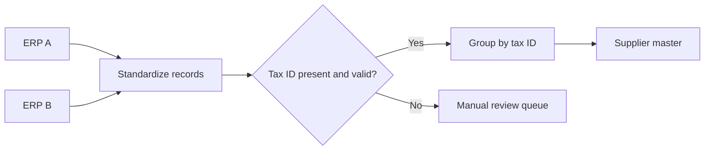

<h1 align="center">Hi, I’m Vivian La Farina 👋</h1>

  <strong>IT Data Project Lead · Global Supply Chain Data Programs</strong>

  
  

> I lead enterprise data projects that impact supply chain operations across the Americas, EMEA, and APAC. I bring regional business teams and global engineering teams together to deliver SAP master data, data quality, and governance initiatives, adapting global standards to regional needs.

## 🌎 What I lead

| Global program delivery | Supply chain data | Architecture & governance |
| :--- | :--- | :--- |
| Cross-regional workstreams, dependencies, and delivery risks | Supplier and purchasing master data, standardization, and data quality | Architecture reviews, integration planning, and data governance |

## 🚧 Now building: Supplier Master Data Platform

**The problem:** Two ERP systems can list the same supplier under different names and IDs. How do we consolidate those records without merging the wrong companies?

**The design decision:** Group records by a valid tax ID in the demo dataset. When a tax ID is missing or invalid, send the record for manual review instead of guessing from the supplier name. Keep the original source and ID so the result can be traced back.

**Status:** In development · Synthetic data only  
**Planned stack:** Python · SQL · DuckDB  
**First test:** Reload the same file and verify that no new supplier records are created.

<strong>🛠 Tools and platforms</strong>

- **Enterprise data and analytics:** SAP/MDG, SQL, Power BI
- **Cloud data platforms:** Azure, Snowflake, Microsoft Fabric
- **Program delivery:** Planisware, Jira, Confluence

