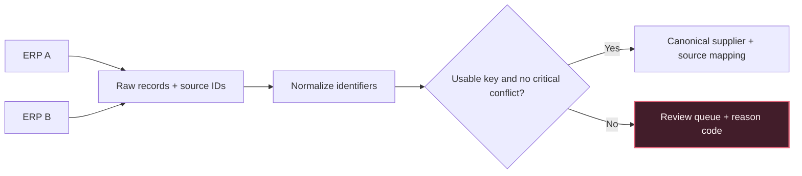

# Vivian La Farina

**IT Data Project Lead | Global Data Program Delivery in MedTech**  
SAP Master Data · Data Quality · Portfolio Governance

I lead enterprise data workstreams for Medtronic’s Global Operations & Supply Chain organization across the Americas, EMEA, and APAC. I translate supplier and purchasing data requirements into delivery plans, coordinate architecture reviews and validation with engineering and business teams, and track the risks and dependencies that can affect a rollout.

[LinkedIn](https://www.linkedin.com/in/vivianlafarina/) · [Portfolio](https://vivianlf.netlify.app/) · [Architecture Lab](#architecture-lab-supplier-master-data-platform)

## Technical delivery & program governance

| Area | What I lead |
| :--- | :--- |
| **Supplier master data** | Lead SAP supplier data standardization workstreams. Coordinate data-quality requirements, user acceptance testing, and handoffs between regional business teams and technical teams. |
| **Purchasing data quality** | Coordinate SAP purchasing data remediation, including price-date controls. Work with business and technical teams to validate changes before rollout. |
| **Architecture & release readiness** | Coordinate architecture reviews and stage-gate approvals. Track open risks, dependencies, and readiness decisions that can affect delivery across regions. |
| **Portfolio governance** | Oversee Planisware project updates for 15 data professionals so leadership can see milestones, delivery risks, and blockers that need action. |
| **Team readiness** | Led onboarding for 50 professionals across disciplines, coordinating role-specific system access and helping resolve blockers that could delay project work. |

*Based in Bogotá, Colombia. I travel as part of my role.*

## Architecture Lab: Supplier Master Data Platform

**In development · Synthetic ERP data only · Python, SQL, DuckDB**

**Business problem.** Two ERP systems can assign different IDs to the same supplier. Leaving duplicates in place fragments spend reporting; merging unrelated suppliers is worse. The lab explores which matches can be automated and which need human review.

### Design decisions

- **Entity resolution.** Match on an exact, normalized tax ID in this demo, not name similarity. For a multi-country implementation, scope the key by issuing jurisdiction and ID type. A format check does not verify legal identity.
- **Survivorship.** If two source records match, define which source takes precedence for each field. Retain the original values and route conflicts in critical attributes to review rather than silently overwriting them.
- **Lineage and exception handling.** Retain the source system and original record ID for every input. For rejected or ambiguous records, record why they were routed to review.
- **Idempotency and reconciliation.** Reload the same files and compare the full supplier master, source mappings, and review queue. A stable supplier count alone can hide duplicated links or review entries.

**First acceptance test:** Four synthetic source rows should yield **two canonical suppliers and one review case**. All four inputs must be traceable, and reloading both files must leave all three outputs unchanged. These are expected results, not production metrics.

<strong>Tools and technical scope</strong>

- **Enterprise delivery:** SAP master data and purchasing, Planisware, Jira, Confluence
- **Data platforms and analytics:** SQL, Power BI, Snowflake, Azure, Microsoft Fabric
- **Portfolio lab:** Python, SQL, DuckDB, synthetic data

